# Valdeir 

  

</h3>

#

<h3 align="LEFT">Sobre mim</h3>
"Estudante de Análise e Desenvolvimento de Sistemas na UNICID, com ênfase em desenvolvimento full stack, com conhecimentos em JavaScript, C, HTML e CSS, adquiridos em projetos acadêmicos, buscando estágio para aplicar e desenvolver competências técnicas em soluções front-end e back-end."

#
<h3 align="left">Linguagens :</h3> 

  
  
  

#

 

  

###

<picture data-importer="pacman">
  <source media="(prefers-color-scheme: dark)" srcset="https://raw.githubusercontent.com/valdeir786/valdeir786/pacman-output/pacman-contribution-graph-dark.svg?game=pacman">
  <source media="(prefers-color-scheme: light)" srcset="https://raw.githubusercontent.com/valdeir786/valdeir786/pacman-output/pacman-contribution-graph.svg?game=pacman">
  
</picture>
#

###

<i>"Transformando requisitos em código com análise, precisão e uma pitada de criatividade".</i>

